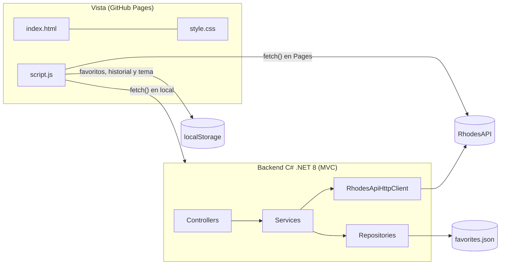

# Rhodes Terminal · Explorador interactivo de operadores de Arknights

Aplicación web que consulta en vivo los 335 operadores de *Arknights* desde RhodesAPI y permite buscarlos, filtrarlos, ordenarlos, compararlos y guardarlos como favoritos con notas tácticas. El frontend estático (HTML, CSS y JavaScript) se publica en GitHub Pages, y el backend opcional en C# (.NET 8) aplica POO, MVC, SOLID y CRUD.

- **Aplicación en GitHub Pages:** https://juulren.github.io/Web-Project-Rhodes-AI/
- **Repositorio:** https://github.com/Juulren/Web-Project-Rhodes-AI

---

## Integrantes

| Integrante | Usuario de GitHub | Rol |
|---|---|---|
| Julio | [@Juulren](https://github.com/Juulren) | Desarrollo completo: frontend, backend C#, pruebas, documentación y publicación (proyecto individual) |

---

## Descripción

Rhodes Terminal es la «terminal táctica» de un Doctor de Rhodes Island: un catálogo vivo de operadores que ayuda a decidir a quién desplegar.

- **Datos reales con `fetch()`:** la página descarga el catálogo de RhodesAPI y lo normaliza, porque la API trae números como texto, campos que a veces son texto y a veces arreglo, y enlaces de imagen rotos. Con eso pinta 335 tarjetas con retrato, rareza, clase, afiliación, descripción y estadísticas.
- **Buscador en tiempo real** por nombre, facción o palabras de la descripción y la biografía, sin distinguir mayúsculas ni acentos.
- **Filtros combinados** por clase, rareza y afiliación, con un contador «X de 335 operadores».
- **Favoritos con CRUD completo:** se guardan en `localStorage`, con rol en el escuadrón, prioridad, calificación, promoción preferida y una nota táctica editable.
- **Manejo de errores:** si una búsqueda no tiene resultados aparece un estado vacío, y si la API falla se muestra el motivo (500, 404, tiempo agotado o sin red) con un botón de reintento.
- **Diseño responsivo** pensado primero para el celular, con menú de pantalla completa, y con una identidad visual propia inspirada en la terminal PRTS de Arknights ([docs/design/frontend-aesthetics.md](docs/design/frontend-aesthetics.md)).
- **Los 5 retos adicionales de la tarea:** tema oscuro y claro, orden alfabético y por rareza, estadísticas dinámicas, comparador de dos operadores e historial de búsquedas.

Cuando el backend C# corre en el equipo, la página lo consulta primero (`http://localhost:5000/api/operators`) y sincroniza los favoritos con su CRUD REST. En GitHub Pages usa RhodesAPI y `localStorage` sin que el usuario note la diferencia.

---

## Instrucciones de uso

### Usar la aplicación publicada

1. Abre https://juulren.github.io/Web-Project-Rhodes-AI/. La primera carga descarga unos 5 MB de RhodesAPI y luego guarda una copia local por 6 horas.
2. **Buscar:** escribe en «Buscar operador» (por ejemplo `lungmen` o `heals`). Pulsa Enter para guardar la búsqueda en el historial.
3. **Filtrar y ordenar:** combina Clase, Rareza y Afiliación, y elige un orden: de la A a la Z, de la Z a la A, o por rareza. «Quitar filtros» limpia la búsqueda y los filtros.
4. **Favoritos:** pulsa **Guardar** en una tarjeta. En «Tu escuadrón de favoritos», **Editar ficha** abre el editor de rol, prioridad, calificación, promoción y nota (hasta 500 caracteres), y **Quitar** lo elimina.
5. **Comparar:** pulsa **Comparar** en dos tarjetas, o abre el comparador desde la barra y elige al Operador A y al Operador B.
6. **Tema:** el botón con el sol o la luna cambia entre el tema oscuro táctico y el claro de laboratorio, y recuerda tu elección.

### Ejecutar el frontend en local

Hace falta un servidor estático, porque abrir el archivo con `file://` bloquea las rutas relativas:

```bash
python -m http.server 8080
```

Después abre http://localhost:8080.

### Ejecutar el backend C# (.NET 8)

```bash
dotnet run --project Backend/RhodesAI.Backend --launch-profile http
```

La API queda en http://localhost:5000, con Swagger en http://localhost:5000/swagger. Si abres el frontend en `localhost`, la página detecta el backend sola.

| Método | Ruta | Descripción |
|---|---|---|
| GET | `/api/operators` | Catálogo completo normalizado |
| GET | `/api/operators/filter?search=&class=&rarity=&affiliation=&sortBy=` | Búsqueda, filtros y orden (`NameAsc`, `NameDesc`, `RarityDesc`, `RarityAsc`) |
| GET | `/api/operators/stats?...` | Estadísticas dinámicas del grupo filtrado |
| GET | `/api/operators/{name}` | Detalle de un operador |
| POST | `/api/comparisons` | Comparación de dos operadores: `{ "operatorA": "Saria", "operatorB": "Exusiai" }` |
| GET, POST | `/api/favorites` | Leer todos y crear |
| GET, PUT, DELETE | `/api/favorites/{id}` | Leer uno, actualizar y eliminar |

Los favoritos del backend se guardan en `Backend/RhodesAI.Backend/App_Data/favorites.json`. Con `"Favorites": { "Storage": "memory" }` en `appsettings.json` se usan en memoria.

### Ejecutar las pruebas

```bash
npm install
```

```bash
npm test
```

```bash
dotnet test Backend/RhodesAI.sln
```

---

## Arquitectura técnica



```text
Web-Project-Rhodes-AI/
├── index.html · style.css · script.js     Vista desacoplada, publicada en GitHub Pages
├── 404.html · privacidad.html · terminos.html
├── assets/                                 favicon, placeholder y mapa de retratos verificados
├── tests/frontend/                         pruebas JS (node --test + jsdom)
├── tools/build_operator_portraits.py       generador del mapa de retratos
└── Backend/
    ├── RhodesAI.Backend/   Controllers · Models (Base, Domain, DTOs) · Services · Repositories
    └── RhodesAI.Tests/     pruebas xUnit
```

### POO

- **Abstracción:** `BaseEntity` es abstracta y define la identidad, `CreatedAt` y `UpdatedAt`, y un `Validate()` virtual que cada entidad amplía.
- **Herencia:** `Operator` y `FavoriteSquadMember` heredan de `BaseEntity`, y `CombatOperator` hereda de `Operator`.
- **Encapsulamiento:** las propiedades tienen `private set`. El estado solo cambia por métodos del dominio (`UpdateTacticalNotes`, `ChangePriority`, `Promote`), que validan sus invariantes: rareza de 1 a 6, prioridad de 1 a 5, nota de hasta 500 caracteres, y un 3★ no puede pasar de Élite 1.
- **Polimorfismo:** `CalculateCombatPower()` es virtual en `Operator` (multiplica según la promoción) y `CombatOperator` lo sobrescribe para ponderar según la clase táctica. Los Defenders valoran DEF y bloqueo, los Snipers y Casters el DPS, los Vanguards el bajo coste y los Specialists el redespliegue.

### MVC

- **Modelos:** entidades del dominio (`Operator`, `OperatorStats`, `FavoriteSquadMember`) y DTOs (`OperatorFilterDto`, `DynamicStatsSummaryDto`, `ComparisonResultDto`).
- **Vista:** `index.html`, `style.css` y `script.js`, servidos de forma estática.
- **Controladores:** `OperatorsController`, `FavoritesController` y `ComparisonsController`. Traducen errores a HTTP: 404, 409 por duplicado, 400 por validación y 503 cuando RhodesAPI cae.

### Los 5 principios SOLID

| Principio | Cómo se aplica |
|---|---|
| **Responsabilidad única** | `RhodesApiHttpClient` solo descarga, `RhodesOperatorAdapter` solo convierte el JSON, `RhodesOperatorService` solo aplica reglas de negocio y `InMemoryFavoriteRepository` y `JsonFileFavoriteRepository` solo persisten. |
| **Abierto/Cerrado** | `IStatCalculatorStrategy` permite agregar fórmulas de evaluación (como `EliteTwoStatCalculator`) registrándolas en `Program.cs`, sin modificar el servicio. |
| **Sustitución de Liskov** | El repositorio en memoria y el de archivo JSON pasan la misma suite de contrato (`FavoriteRepositoryContractTests.cs`) y se intercambian con `Favorites:Storage`. |
| **Segregación de interfaces** | `IOperatorReadService`, `IOperatorStatsService` e `IFavoriteCrudService` son contratos pequeños; cada controlador pide solo lo que usa. |
| **Inversión de dependencias** | Los controladores dependen de abstracciones registradas en el contenedor de `Program.cs` (`AddScoped`, `AddSingleton`, `AddHttpClient`). |

### CRUD de favoritos

| Operación | Backend (`FavoritesController`) | Frontend (`createFavoritesStore`) |
|---|---|---|
| Create | `POST /api/favorites` (409 si está repetido) | Botón **Guardar** de la tarjeta |
| Read | `GET /api/favorites` y `GET /api/favorites/{id}` | Sección «Tu escuadrón de favoritos» |
| Update | `PUT /api/favorites/{id}` | Modal **Editar ficha** |
| Delete | `DELETE /api/favorites/{id}` | Botón **Quitar** |

En el navegador, `localStorage` es la fuente de verdad. Con el backend activo, `createFavoritesSync` replica cada operación en la API y guarda el id remoto.

### Diseño: «PRTS, la terminal de Rhodes Island»

La primera versión seguía al pie de la letra [SKILLS.md](SKILLS.md) y quedaba correcta pero genérica. La rediseñamos con las pautas de [docs/design/frontend-aesthetics.md](docs/design/frontend-aesthetics.md), que reemplazan a SKILLS.md donde chocan. Lo demás de SKILLS.md sigue vigente: estados de interacción, accesibilidad, redacción sin guiones y requisitos de publicación.

- **Tipografía:**
  - *Big Shoulders Display*, condensada e industrial, para los títulos en mayúsculas.
  - *Familjen Grotesk* para el texto.
  - *Martian Mono* para datos, etiquetas e índices.
  - Inter, Roboto, Arial y las fuentes del sistema quedan prohibidas.
- **Color:** todo vive en variables CSS:
  - **Tema oscuro:** tinta casi negra dominante, cian PRTS (`--accent`) como acento principal y naranja de originium (`--hot`) como acento cortante.
  - **Tema claro:** papel de laboratorio con verde azulado profundo.
  - Cada rareza tiene su color (`--r1` a `--r6`), que tiñe las estrellas y la afiliación de la tarjeta.
- **Fondo con atmósfera:** resplandores radiales, una retícula técnica de 48 px y líneas de barrido de monitor, más bandas de franjas de peligro (`repeating-linear-gradient`) en el tagline, el terminal y el pie.
- **Formas:** esquinas biseladas con `clip-path` en lugar de esquinas redondeadas. El borde es el fondo de la pieza y un `::before` hace de relleno. Las barras de estadísticas y del comparador son segmentadas, como una carga de batería.
- **Movimiento:**
  - Una entrada de página orquestada: la barra cae, el titular se revela línea por línea con `clip-path` y la bajada, el CTA y el terminal suben en cascada, todo con `animation-delay` y la variable `--d`.
  - Las tarjetas entran escalonadas con `--i`, y un barrido de escáner recorre el retrato al pasar el cursor.
  - Con `prefers-reduced-motion` todo queda quieto.
- **Estructura:** índices numerados por sección («01 Inteligencia»), riel vertical y marca de agua «RHODES» en el hero, y un sello «En línea» en el terminal.

`FrontendContractTests.cs` verifica estas decisiones de forma automática: el trío tipográfico, la ausencia de fuentes genéricas, la escala tipográfica y de espaciado por tokens, los biseles, el fondo en capas, los colores solo en variables y la entrada escalonada.

---

## Retos adicionales

Los cinco retos de la Sección 5 de la tarea están implementados en el [Pull Request #1](https://github.com/Juulren/Web-Project-Rhodes-AI/pull/1):

1. **Modo oscuro y claro:** botón accesible (`aria-pressed`) con la preferencia guardada en `localStorage`. Si no hay preferencia, respeta `prefers-color-scheme`. Un script en `<head>` aplica el tema antes del primer pintado para evitar destellos.
2. **Orden alfabético y por rareza:** de la A a la Z, de la Z a la A, y por rareza de mayor a menor o de menor a mayor. Ignora comillas y acentos, y desempata por nombre.
3. **Estadísticas dinámicas:** total, promedios de HP, ATK, DEF y coste de DP, y la distribución por clase y por rareza del grupo visible, recalculados en cada búsqueda o filtro.
4. **Comparador de dos personajes:** HP, ATK, DEF, RES, coste, bloqueo e intervalo de ataque, con barras proporcionales, el ganador de cada atributo resaltado y un veredicto. En coste e intervalo gana el valor menor.
5. **Historial de búsquedas:** hasta 8 búsquedas, sin duplicados, como chips que repiten la búsqueda con un clic, y un botón para limpiar el historial.

### Issues y Pull Request

| Elemento | Tema | Estado |
|---|---|---|
| [Issue #2](https://github.com/Juulren/Web-Project-Rhodes-AI/issues/2) | Normalización de datos e imágenes faltantes en ciertos operadores de RhodesAPI | Cerrado (commit `df62d24`) |
| [Issue #3](https://github.com/Juulren/Web-Project-Rhodes-AI/issues/3) | Panel comparador de 2 operadores y estadísticas dinámicas en tiempo real | Cerrado (PR #1) |
| [Pull Request #1](https://github.com/Juulren/Web-Project-Rhodes-AI/pull/1) | `feature/retos-interactivos` → `main` con los 5 retos | Fusionado (commit `a90fa57`) |

GitHub usa una sola numeración para Issues y Pull Requests; por eso los Issues son el #2 y el #3. Los textos completos están en [docs/issues](docs/issues) y [docs/pull-requests](docs/pull-requests).

---

## Pruebas

El proyecto se desarrolló con TDD en 6 secciones. En cada una, las pruebas se escribieron primero y se ejecutaron fallando (RED); después se implementó el código hasta que pasaron (GREEN). Las salidas de cada corrida están en [docs/test-reports](docs/test-reports).

| Suite | Herramienta | Qué cubre |
|---|---|---|
| `DomainTests.cs` | xUnit | Abstracción, encapsulamiento, herencia y polimorfismo del dominio |
| `FavoriteCrudTests.cs` y `FavoriteRepositoryContractTests.cs` | xUnit | CRUD, duplicados, contrato de Liskov y persistencia en JSON |
| `OperatorServiceTests.cs` | xUnit | Adaptador del JSON de RhodesAPI y fallos HTTP 500 y 404 |
| `ChallengesServiceTests.cs` | xUnit | Orden, distribuciones y comparador en el backend |
| `FrontendContractTests.cs` | xUnit + AngleSharp | Estructura del DOM y reglas del sistema visual (docs/design) |
| `DeliverablesTests.cs` | xUnit | Este README y los archivos obligatorios de la tarea |
| `tests/frontend/*.test.js` | `node --test` + jsdom | Normalización, `fetch()` con fallback, renderizado, filtros, favoritos y los 5 retos sobre el `index.html` real |

---

## Dificultades

- **La API del plan no existía.** `api.rhodesapi.com` no resuelve DNS. Encontramos la instancia vigente (`rhodesapi.up.railway.app`) y la dejamos configurable en `appsettings.json` y en `CONFIG.publicApiUrl`.
- **Todas las imágenes estaban rotas.** Los enlaces `art` apuntan a `ak.gamepress.gg`, que tampoco existe. Lo explicamos en «Error encontrado y cómo lo resolvimos».
- **Datos sucios:** `"block: 2"`, `"09"`, afiliaciones que llegan como texto o arreglo, 34 operadores sin `e2max`, rareza 0 y un operador sin estadísticas. Además, el coste DP viene mal en muchos casos (Thorns aparece con 96); como no se puede corregir desde el cliente, se muestra tal como llega y el promedio de coste del panel debe leerse con cautela.
- **5,5 MB por carga.** Guardamos una copia normalizada de unos 270 KB en `localStorage` durante 6 horas. Si RhodesAPI cae, se usa esa copia aunque esté vencida y se avisa en el contador.
- **Herramientas locales:** PowerShell 5.1 rompía los mensajes de commit con comillas, así que usamos `git commit -F`. Además, `gh` no estaba instalado; lo instalamos para fusionar el Pull Request, crear los Issues y activar GitHub Pages.

---

## Uso de inteligencia artificial

Usamos **Claude (Claude Code, modelo Claude Opus)** como asistente de desarrollo, siguiendo el plan maestro [prompt.md](prompt.md). El plan obliga a trabajar sección por sección, con pruebas RED antes del código, GREEN después, commit y push, y una pausa para revisar y aprobar antes de avanzar. Revisamos cada sección antes de pasar a la siguiente.

### Tres prompts importantes

#### Prompt 1: plan maestro con TDD y pausas de control

> «Actúa como un Arquitecto de Software Senior Full-Stack especialista en C# (.NET), Desarrollo Web Frontend Moderno y Desarrollo Guiado por Pruebas (TDD) […] PROHIBIDO generar o ejecutar todo el proyecto de una sola vez. El desarrollo está dividido en 6 Secciones […] Fase RED […] Fase GREEN […] Commit y Push […] PAUSA OBLIGATORIA DE CONTROL.»

**Por qué fue importante:** definió el método de trabajo. Al exigir pruebas que fallen primero y una pausa por sección, pudimos revisar cada avance, ver qué hacía cada parte y pedir cambios antes de seguir.

#### Prompt 2: arranque con la tarea como referencia

> «Ejecuta el plan de implementacion.md siguiendo lo que se te pide, en caso de dudas consultar Tarea 3.pdf»

**Por qué fue importante:** obligó a contrastar el plan con la consigna oficial. Al leer la tarea aparecieron requisitos que el plan no tenía, como activar GitHub Pages, y diferencias que tuvimos que decidir nosotros.

#### Prompt 3: automatizar lo que faltaba en GitHub

> «eso no lo puedes hacer tu? instala gh»

**Por qué fue importante:** el Pull Request lo creamos desde la web, pero quedaba fusionarlo y crear los Issues. Con este pedido la IA instaló GitHub CLI y, después de que iniciamos sesión con nuestra cuenta, fusionó el PR con un commit de merge, creó y cerró los Issues #2 y #3 y activó GitHub Pages.

### Respuesta de la IA que requirió correcciones

En la Sección 1, la IA generó un `RhodesApiHttpClient` que leía los números de RhodesAPI de esta forma:

**Lo que propuso la IA:**

```csharp
private static double ReadNumber(JsonElement json, string property)
{
    if (json.ValueKind != JsonValueKind.Object || !json.TryGetProperty(property, out var value))
        return 0;
    return value.ValueKind switch
    {
        JsonValueKind.Number => value.GetDouble(),
        JsonValueKind.String when double.TryParse(value.GetString()?.Trim(), NumberStyles.Float,
            CultureInfo.InvariantCulture, out var parsed) => parsed,
        _ => 0
    };
}
// ...
block: (int)Math.Max(ReadNumber(tier, "block"), ReadNumber(baseBlock, "block")),
```

**Por qué fallaba:**
- `double.TryParse("block: 2")` falla, así que devolvía 0 y ese bloqueo se perdía en silencio.
- Devolver 0 en lugar de «sin dato» hacía imposible distinguir un valor vacío de un cero real.
- Operadores como Ulpianus, cuyos tiers solo traen `{"error": ...}`, terminaban con todas sus estadísticas en 0 y ensuciaban los promedios.
- El `artUrl` seguía apuntando a `ak.gamepress.gg`, que no existe.

Lo descubrimos al probar la API real con PowerShell (`Saria: "block": "block: 2", "cost": "09"`).

**Cómo lo corregimos:** con pruebas RED en `OperatorServiceTests.cs` y `normalize.test.js` (Sección 3), separamos la conversión en `RhodesOperatorAdapter` (responsabilidad única) y cambiamos la lectura para que extraiga el primer número y devuelva `null` cuando no hay ninguno:

```csharp
private static double? ReadNumber(JsonElement json, string property)
{
    // ...
    var match = FirstNumber().Match(value.GetString()!);   // regex -?\d+(?:\.\d+)?
    return match.Success ? double.Parse(match.Value, CultureInfo.InvariantCulture) : null;
}
// ...
block: ToInt(ReadNumber(tier, "block") ?? ReadNumber(baseBlock, "block") ?? 1),
```

Además, un tier sin HP válido se omite, un operador sin ningún tier válido se descarta, y el retrato se reconstruye con su identificador interno.

### Error encontrado y cómo lo resolvimos

**Error:** al conectar el catálogo, todas las tarjetas salieron sin imagen. El campo `art` de RhodesAPI enlaza a `ak.gamepress.gg`, y el dominio no resuelve DNS (`The remote name could not be resolved`). Además, 82 operadores recientes tienen nombres de archivo en chino (`立绘_伊内丝_1.png`), así que tampoco servía buscar sus imágenes por el nombre del archivo.

**Cómo lo resolvimos:**
1. Probamos repositorios públicos de recursos del juego y comprobamos con solicitudes `HEAD` que `yuanyan3060/ArknightsGameResource` tiene los retratos de todos los operadores, incluidos los más nuevos.
2. Escribimos [tools/build_operator_portraits.py](tools/build_operator_portraits.py). El script obtiene el identificador `char_XXX_nombre` del enlace original o, en los nombres en chino, del campo `appellation` de la tabla oficial del juego. Después verifica que el retrato exista (primero el de Élite 2 y si no el de Élite 1) y genera [assets/data/operator-portraits.json](assets/data/operator-portraits.json): 337 de 338 resueltos, unos 12 KB.
3. `resolveArt()` en `script.js` usa el mapa; si un operador no está, lo deduce del enlace, y si nada funciona usa `assets/operator-placeholder.svg`. Una imagen que falla al cargar se reemplaza por el placeholder.

Lo registramos en el [Issue #2](https://github.com/Juulren/Web-Project-Rhodes-AI/issues/2).

### Modificación explicada

Explicamos el funcionamiento de los 5 retos (Sección 5 de la tarea). Todos siguen la misma idea: una función pura en `script.js`, probada por separado, y una función de vista que la conecta con el DOM.

**Reto 2: `sortOperators`.**

```js
const SORTERS = {
  "name-asc": (a, b) => compareNames(a.name, b.name),
  "name-desc": (a, b) => compareNames(b.name, a.name),
  "rarity-desc": (a, b) => b.rarity - a.rarity || compareNames(a.name, b.name),
  "rarity-asc": (a, b) => a.rarity - b.rarity || compareNames(a.name, b.name)
};
function sortOperators(operators, key) {
  return [...operators].sort(SORTERS[key] || SORTERS["name-asc"]);
}
```

- Cada clave del `<select id="sort-select">` corresponde a una función de comparación.
- `compareNames` usa `localeCompare("es", { sensitivity: "base", ignorePunctuation: true })`, así que `'Justice Knight'` queda junto a la J y «Ángel» junto a la A.
- En rareza, `b.rarity - a.rarity || ...` desempata por nombre cuando la resta da 0.
- `[...operators]` copia la lista para no alterar el catálogo original, y una clave desconocida cae en A a Z.

**Reto 3: `computeStats`.** Recibe el grupo visible ya filtrado:
- `average(key)` suma `op.stats[key]` con `reduce`, divide por el total y redondea a un decimal; con lista vacía devuelve 0 y nunca divide por cero.
- La distribución por clase cuenta en un `Map`, calcula el porcentaje y ordena de mayor a menor.
- La de rareza recorre siempre `[6, 5, 4, 3, 2, 1]`, para que aparezcan las seis barras aunque alguna esté en 0.

`renderStats` vuelca los números en `[data-stat]` y dibuja cada barra con la variable CSS `--value`. El CSS la aplica como `clip-path: inset(0 calc((1 - var(--value)) * 100%) 0 0)`, que recorta la barra segmentada sin deformar sus segmentos (con `scaleX` se aplastaban). `initCatalog().apply()` la llama después de cada búsqueda, filtro u orden.

**Reto 4: `compareOperators`.**

```js
const winner = valueA === valueB ? "Empate" : (valueA > valueB) !== lowerIsBetter ? "A" : "B";
return { key, label, lowerIsBetter, winner, a: valueA, b: valueB,
         ratioA: max > 0 ? valueA / max : 0, ratioB: max > 0 ? valueB / max : 0 };
```

- Para cada atributo de `COMPARE_ATTRIBUTES`, `(valueA > valueB) !== lowerIsBetter` invierte la decisión cuando gana el menor. Por eso con Saria contra Exusiai gana B en coste (12 frente a 20) aunque 20 sea mayor.
- `ratioA` y `ratioB` miden cada barra respecto al mayor de los dos valores; si ambos son 0 la barra queda en 0, sin dividir por cero.
- `winsA` y `winsB` cuentan los atributos ganados y `overall` da el veredicto.
- `initComparator` llena los dos `<select>`. El primer clic en **Comparar** de una tarjeta va a A y el segundo a B, y si se elige el mismo operador dos veces se muestra un aviso en lugar de un empate.

**Reto 5: `createSearchHistory`.**
- `add(term)` limpia los espacios e ignora los términos de menos de 2 caracteres.
- Quita cualquier versión anterior del mismo término comparando con `normalizeSearch`, sin importar mayúsculas ni acentos, pone el término nuevo al principio, recorta a 8 y guarda en `localStorage` (`rhodes.history.v1`).
- La búsqueda se registra con el evento `change` (al salir del campo) o al pulsar Enter, no con cada tecla, para no llenar el historial de búsquedas a medias.
- Cada chip vuelve a escribir su término y llama a `catalog.apply()`.

**Reto 1: `resolveInitialTheme`.**
- Devuelve el tema guardado en `rhodes.theme` si es `light` o `dark`; si no hay, consulta `matchMedia("(prefers-color-scheme: light)")`, y si nada de eso funciona usa el oscuro.
- `applyTheme` cambia `data-theme` en `<html>`, que activa los tokens de color de `:root[data-theme="light"]` en el CSS, y actualiza `aria-pressed`, la etiqueta del botón y el color de la barra del navegador.
- El script pequeño en `<head>` repite esta lógica antes del primer pintado, para que no destelle el tema oscuro al recargar en claro.

### Reflexión del equipo

La IA aceleró muchísimo el trabajo, pero lo más valioso no fue que escribiera código sino que nos obligó a verificarlo. Varias decisiones del plan generado por IA eran incorrectas: la URL de la API, que los enlaces de imagen funcionaban, o que el coste DP era confiable. Solo lo descubrimos al probar contra los datos reales. Si hubiéramos aceptado la primera respuesta, la página habría salido sin imágenes y con estadísticas en cero.

TDD funcionó como freno de seguridad. Ver primero la prueba en rojo nos confirmaba que de verdad comprobaba algo; dos veces una prueba pasó antes de implementar y tuvimos que reforzarla porque no probaba nada. Las pausas por sección nos dieron tiempo de leer cada cambio y entenderlo, que es lo que exige la presentación. Aprendimos que la IA es un buen compañero para proponer y escribir, pero que la responsabilidad de que el resultado sea correcto sigue siendo nuestra.

---

## Preguntas para la presentación

**1. ¿Qué función cumple fetch() dentro de su aplicación?**

`fetch()` es la función del navegador con la que la página pide datos por HTTP sin recargarse. En `script.js`, la función `fetchJson()` la envuelve con un `AbortController` que cancela la solicitud si tarda demasiado (60 segundos para RhodesAPI y 2,5 para el backend local) y convierte cada fallo en un `ApiError` de tipo `http`, `timeout`, `network` o `parse`. `loadOperators()` la usa en orden: primero el backend C# si estamos en `localhost`, luego RhodesAPI, y el resultado pasa por `normalizeList()` antes de pintarse. También se usa para descargar el mapa de retratos y para sincronizar los favoritos con `POST`, `PUT` y `DELETE`.

**2. ¿Qué diferencia existe entre HTML, CSS y JavaScript en el proyecto?**

HTML (`index.html`) define la estructura y el significado del contenido: la navegación, las secciones, el buscador con su `<label>`, los selectores de filtro, los `<dialog>` del comparador y del editor de notas, y la `<template>` de la tarjeta que JavaScript clona. CSS (`style.css`) define la presentación: los tokens de color, tipografía y espaciado, los temas oscuro y claro, las esquinas biseladas, el fondo con retícula, la grilla responsiva con sus breakpoints y las animaciones de entrada. JavaScript (`script.js`) aporta el comportamiento: descarga los datos con `fetch()`, los normaliza, filtra y ordena, pinta las tarjetas, guarda los favoritos en `localStorage` y responde a cada clic o tecla.

**3. ¿Cómo funciona el buscador y el sistema de filtros que desarrollaron?**

Al escribir en `#search-input`, el evento `input` espera 150 ms sin nuevas teclas y llama a `apply()`. `readFilters()` lee el texto, la clase, la rareza, la afiliación y el orden. `filterOperators()` pasa el texto por `normalizeSearch()` (minúsculas, sin acentos y con espacios simples) y lo divide en palabras; un operador pasa si cada palabra aparece en su texto indexado, que reúne nombre, clase, arquetipo, afiliaciones, descripción y biografía y se calcula una sola vez por operador con un `WeakMap`. Los filtros se combinan con lógica AND, después se aplica `sortOperators()` y se repintan las tarjetas, el contador y el panel de estadísticas. Si no queda nada, aparece el estado vacío con un botón para quitar los filtros.

**4. ¿Qué sucede internamente y en la interfaz cuando la API no responde?**

Internamente, `fetchJson()` lanza un `ApiError`: `timeout` si pasó el tiempo límite, `network` si no hubo conexión, `http` con el código si la respuesta fue 404 o 500, y `parse` si llegó algo que no es JSON. `loadOperators()` prueba la siguiente fuente; si todas fallan, usa la copia guardada en `localStorage` aunque esté vencida y la marca como desactualizada, y solo si no hay copia propaga el error. En la interfaz, `showState("error")` oculta la grilla y muestra el aviso con un mensaje específico de `describeError()`, por ejemplo «RhodesAPI respondió con un error interno (500)», junto con el botón «Reintentar conexión», que vuelve a cargar ignorando la caché. Los favoritos siguen disponibles porque viven en `localStorage`. En el backend, el controlador responde 503 con un `ProblemDetails`.

**5. ¿Qué parte del código fue generada por la IA y qué modificaciones realizaron ustedes?**

La IA (Claude) generó la mayor parte del código a partir del plan: el backend C#, `index.html`, `style.css`, `script.js` y las pruebas. Nuestro trabajo fue dirigir, revisar y aprobar cada sección. Al probar contra los datos reales se corrigió lo que fallaba: la URL de la API, el lector de números que no entendía `"block: 2"`, los retratos de un dominio que ya no existe (con el mapa de retratos verificado), el descarte de operadores sin estadísticas, los cortes de línea del título y del tagline que SKILLS.md no permite, un rediseño visual completo cuando la primera versión resultó demasiado genérica, el orden alfabético que dejaba primero a `'Justice Knight'` y la columna de porcentajes que partía «20,6 %». Cada corrección se hizo escribiendo primero una prueba que fallara y está explicada en este README.

**6. ¿Cómo publicaron su aplicación mediante GitHub Pages?**

El repositorio es público y tiene `index.html`, `style.css` y `script.js` en la raíz, con rutas relativas (`style.css`, `assets/...`) para que funcionen dentro de la subruta `/Web-Project-Rhodes-AI/`. Activamos GitHub Pages con la fuente «Deploy from a branch», rama `main` y carpeta raíz (`/`), usando la API de GitHub con `gh`; en la web es Settings, luego Pages, luego Branch: main. Agregamos `.nojekyll` para que GitHub sirva los archivos tal cual, sin procesarlos con Jekyll. GitHub construye el sitio en cada push a `main` y lo publica en https://juulren.github.io/Web-Project-Rhodes-AI/, y `404.html` se usa automáticamente para rutas inexistentes. RhodesAPI responde con CORS abierto, así que el navegador puede consultarla directamente desde Pages por HTTPS.
